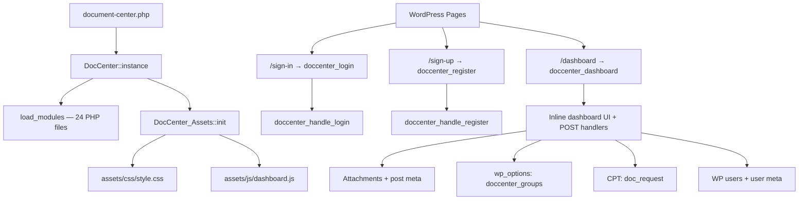
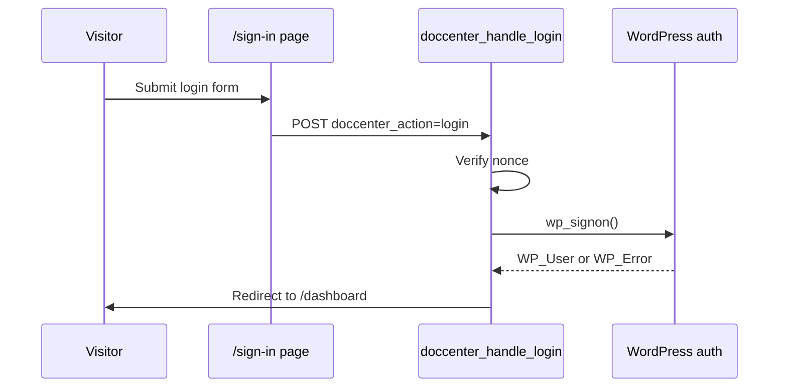
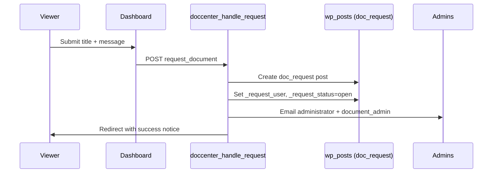

# Document Center — Complete Documentation

Technical documentation for the **Document Center** WordPress plugin **v2.6**. This is the single source of truth for setup, architecture, data, roles, UI, handlers, functions, and security.

The plugin replaces wp-admin for document management with a frontend dashboard: role-based access, viewer groups, attachment-based files, and a request workflow.

**Quick facts**

- **Entry point:** `document-center.php` → `DocCenter::instance()`
- **Primary UI:** `[doccenter_dashboard]` in `includes/shortcodes/dashboard.php`
- **Required pages:** `sign-in`, `sign-up`, `dashboard`
- **Function prefix:** `doccenter_*`
- **Storage:** WordPress core only — no custom database tables
- **Version constant:** `DOCCENTER_PLUGIN_VERSION` (`2.6`)

Related user-facing overview: [README.md](../README.md).

---

## Table of contents

1. [Overview](#1-overview)
2. [Installation and setup](#2-installation-and-setup)
3. [Architecture](#3-architecture)
4. [Dashboard UI](#4-dashboard-ui)
5. [Data model](#5-data-model)
6. [Roles and permissions](#6-roles-and-permissions)
7. [User flows](#7-user-flows)
8. [Handlers reference](#8-handlers-reference)
9. [Function reference](#9-function-reference)
10. [Developer guide](#10-developer-guide)
11. [Security](#11-security)

---

## 1. Overview

### Features

- **Frontend dashboard** — Upload, browse, search, and manage documents without wp-admin.
- **Role-based access** — Document Super Admin, Document Admin, Document Viewer. WordPress `administrator` is treated as super admin.
- **Viewer groups** — Hierarchical groups; share documents by group.
- **Document visibility** — Admins only, everyone, or custom users/groups.
- **Document requests** — Viewers request files; admins reply and close.
- **User management** — Create users, assign groups, promote/demote (super admin).
- **Unique document tags** — Searchable alphanumeric tag per file.
- **Auth pages** — Login and registration shortcodes with redirect logic.

### Plugin structure

```
document-center/
├── document-center.php              # Plugin bootstrap
├── README.md
├── docs/DOCUMENTATION.md            # This file
├── assets/
│   ├── css/style.css                # Enqueued dashboard styles
│   ├── css/dashboard.css            # Duplicate of inline CSS (not enqueued)
│   ├── js/dashboard.js              # Enqueued JS (not the live demote path)
│   └── js/dashboard-ui.js           # Duplicate of inline JS (not enqueued)
├── templates/dashboard/             # Unused partials (see Dashboard UI)
└── includes/
    ├── class-doccenter.php          # Main loader
    ├── class-doccenter-assets.php   # Script/style enqueue
    ├── core/                        # Notices, roles, admin bar
    ├── auth/                        # Redirects, login/register
    ├── groups/                      # Group CRUD and member assignment
    ├── documents/                   # Upload, edit, delete, search, visibility
    ├── requests/                    # Document request CPT and handlers
    ├── users/                       # User management
    ├── ajax/                        # AJAX endpoints
    └── shortcodes/                  # Login, register, dashboard views
```

### Changelog (2.6)

- Refactored monolithic core into modular structure
- Added `DocCenter` bootstrap class and `DocCenter_Assets` handler
- Moved assets to `assets/css/` and `assets/js/`
- Fixed `doccenter_handle_group_management` not being hooked to `init`
- Fixed guest redirect running before `ABSPATH` check
- Synced version constant with plugin header

License: GPL v2 or later.

---

## 2. Installation and setup

### Requirements

| Requirement | Minimum |
|-------------|---------|
| WordPress | 5.8+ |
| PHP | 7.4+ |
| Pages | Three published pages with the slugs below |
| Permalinks | Pretty permalinks so `/sign-in`, `/sign-up`, and `/dashboard` resolve |

The plugin has **no activation hook** and creates **no custom tables**. Roles are registered on every `init`. Groups, documents, and requests appear as you use the dashboard.

### Install

1. Copy the `document-center` folder into `wp-content/plugins/`.
2. Activate **Document Center** from WordPress **Plugins**.
3. Create the required pages.
4. Confirm a WordPress administrator (or a user with `document_super_admin`) can open `/dashboard`.

### Required pages

The plugin identifies pages by **slug**, not title.

| Page slug | Shortcode | Purpose |
|-----------|-----------|---------|
| `sign-in` | `[doccenter_login]` | Login form |
| `sign-up` | `[doccenter_register]` | Self-registration (always `document_viewer`) |
| `dashboard` | `[doccenter_dashboard]` | Main application |

If these slugs do not exist:

- Guests redirected to `/sign-in` land on a 404.
- Successful login/register redirects to `/dashboard` also 404.
- Asset enqueue only runs on `is_page('dashboard')`, so CSS/JS never load on a differently named page.

Use a theme template that outputs `the_content()` so the shortcodes render.

### First administrator

WordPress **`administrator`** users are treated as Document Center super admins. After activation, log in as a site admin and open `/dashboard`.

To create a dedicated Document Center super admin from wp-admin: assign role **Document Super Admin** (`document_super_admin`), then sign in through `/sign-in`.

Self-registration always assigns `document_viewer`. Admins create other roles from **Manage users**.

### Redirect behavior

Configured in `includes/auth/redirects.php`:

- **Guests** on any frontend page except `sign-in` and `sign-up` → `/sign-in`.
- **Logged-in** `administrator`, `document_admin`, or `document_viewer` on the site home → `/dashboard`.
- The WordPress admin bar is hidden for **all** users.

This site behaves as a document portal. Other public WordPress pages are not reachable while logged out. See [known gap 5](#5-guest-redirect-scope).

A user with **only** `document_super_admin` is not included in the home → dashboard role list. They can still open `/dashboard` directly.

### Permalinks

Set **Settings → Permalinks** to anything other than Plain. Visit the three pages once after changing permalinks.

### Upload size

The plugin rejects files over **250 MB**. PHP and the web server must allow at least that:

| Setting | Typical location |
|---------|------------------|
| `upload_max_filesize` | `php.ini` |
| `post_max_size` | `php.ini` (must be ≥ `upload_max_filesize`) |
| Nginx `client_max_body_size` | Server config, if used |

WordPress `wp_max_upload_size()` can still block uploads before the plugin’s own check.

### Email

Mail is sent via `wp_mail()`:

| Event | Recipients |
|-------|------------|
| New user created in the dashboard | The new user’s email (credentials) |
| Viewer submits a document request | Users with role `administrator` or `document_admin` |

`document_super_admin` users are **not** included in request notification mail unless they also have `administrator` or `document_admin`. The credentials email uses `wp_login_url()` (wp-login.php), not `/sign-in`.

### Theme logo

The dashboard sidebar uses the Customizer **Site Logo** (`custom_logo`). If none is set, the `` `src` is empty.

### Troubleshooting

| Symptom | Likely cause |
|---------|----------------|
| `/sign-in` or `/dashboard` 404 | Wrong slug, unpublished page, or Plain permalinks |
| Dashboard has no styles / JS | Page slug is not exactly `dashboard`, or user is not logged in |
| Entire public site redirects to sign-in | Intended: guest redirect is global |
| Login fails with no error message | Auth shortcodes do not call `doccenter_render_notices()` |
| Large upload rejected | PHP upload limits, or extension not in the whitelist |
| New request emails never arrive | Mailer not configured, or recipient is only `document_super_admin` |
| Empty sidebar logo | Customizer Site Logo is not set |

### Setup checklist

- [ ] Plugin activated
- [ ] Pages `sign-in`, `sign-up`, `dashboard` published with the matching shortcodes
- [ ] Pretty permalinks enabled
- [ ] At least one administrator can open `/dashboard`
- [ ] PHP upload limits match the 250 MB cap if large files are needed
- [ ] Outgoing mail works if you create users or use document requests

---

## 3. Architecture

Document Center uses WordPress attachments for files, options/user meta for configuration, and one custom post type for document requests.



### Constants

Defined in `document-center.php`:

| Constant | Value | Purpose |
|----------|-------|---------|
| `DOCCENTER_PLUGIN_VERSION` | `2.6` | Cache-busting for assets |
| `DOCCENTER_PLUGIN_DIR` | Plugin directory path | File includes |
| `DOCCENTER_PLUGIN_URL` | Plugin directory URL | Asset URLs |

There is no `register_activation_hook` or uninstall callback.

### Classes

| Class | File | Responsibility |
|-------|------|----------------|
| `DocCenter` | `includes/class-doccenter.php` | Singleton bootstrap; loads all modules |
| `DocCenter_Assets` | `includes/class-doccenter-assets.php` | Enqueues CSS/JS on the dashboard page |

All domain logic lives in **procedural functions** prefixed with `doccenter_*`.

### Module load order

`DocCenter::load_modules()` requires files in this order:

```
core/notices.php
core/admin-bar.php
core/roles.php
auth/redirects.php
auth/auth-styles.php
auth/login-handler.php
auth/register-handler.php
groups/functions.php
groups/management-handler.php
documents/helpers.php
documents/visibility.php
documents/search.php
documents/group-queries.php
documents/upload-handler.php
documents/edit-handler.php
documents/delete-handler.php
documents/mimes.php
requests/cpt.php
requests/handlers.php
users/management-handler.php
users/demote-user.php
ajax/demote-admin.php
shortcodes/login.php
shortcodes/register.php
shortcodes/dashboard.php
```

To add a module: create the file under `includes/`, add an `ABSPATH` guard, append the path to `$modules` in `includes/class-doccenter.php`. See [Developer guide](#10-developer-guide).

### WordPress hooks

**Actions**

| Hook | Callback | File |
|------|----------|------|
| `init` | `doccenter_register_roles` | `core/roles.php` |
| `init` | `doccenter_handle_login` | `auth/login-handler.php` |
| `init` | `doccenter_handle_register` | `auth/register-handler.php` |
| `init` | `doccenter_handle_upload` | `documents/upload-handler.php` |
| `init` | `doccenter_handle_edit_document` | `documents/edit-handler.php` |
| `init` | `doccenter_handle_delete_document` | `documents/delete-handler.php` |
| `init` | `doccenter_handle_group_management` | `groups/management-handler.php` |
| `init` | `doccenter_handle_user_management` | `users/management-handler.php` |
| `init` | `doccenter_demote_user` | `users/demote-user.php` |
| `init` | `doccenter_register_request_cpt` | `requests/cpt.php` |
| `init` | `doccenter_handle_request` | `requests/handlers.php` |
| `init` | `doccenter_handle_request_reply` | `requests/handlers.php` |
| `init` | `doccenter_handle_request_delete` | `requests/handlers.php` |
| `template_redirect` | Guest redirect closure | `auth/redirects.php` |
| `template_redirect` | `doccenter_redirect_home_to_dashboard` | `auth/redirects.php` |
| `wp_enqueue_scripts` | `DocCenter_Assets::enqueue` | `class-doccenter-assets.php` |
| `wp_ajax_doccenter_demote_admin` | `doccenter_demote_admin` | `ajax/demote-admin.php` |

**Filters**

| Hook | Callback | File |
|------|----------|------|
| `upload_mimes` | MIME extension whitelist | `documents/mimes.php` |
| `show_admin_bar` | Returns `false` | `core/admin-bar.php` |

**Shortcodes**

| Tag | Function |
|-----|----------|
| `doccenter_login` | `doccenter_login_shortcode()` |
| `doccenter_register` | `doccenter_register_shortcode()` |
| `doccenter_dashboard` | `doccenter_dashboard_shortcode()` |

### Flash notices

- Logged in: user meta `doccenter_notices` (array; cleared after render)
- Guest: transient `doccenter_notice_{md5(ip+ua)}` for 60 seconds

Handlers call `doccenter_add_notice()`. **Only the dashboard** calls `doccenter_render_notices()`. Login and register shortcodes do not print notices; they only strip `.doccenter-alert` if one were present. Failed login/register flashes are easy to miss.

---

## 4. Dashboard UI

### Live renderer

The running UI is **`doccenter_dashboard_shortcode()`** in `includes/shortcodes/dashboard.php` (~3,200 lines): role-based sidebar, header, all tab panels, modals, ~900 lines of inline CSS, ~700 lines of inline JavaScript.

Guests who hit the shortcode see a “must be logged in” message. In practice the global redirect sends them to `/sign-in` first.

### Shell

```
.doccenter-root
└── .doccenter-shell
    ├── aside.doccenter-sidebar   logo, brand, nav
    └── main.doccenter-main       header + tab sections
```

Brand subtitle is “Admin Dashboard” or “Viewer Dashboard” from `doccenter_is_admin_user()`. Logo is the Customizer site logo. On small screens, `#doccenter-mobile-toggle` toggles `.active` on `#dc-sidebar`.

### Tabs

Tabs are `<section class="doccenter-section" data-tab="...">`. Sidebar items use matching `data-tab`. JS adds `.doccenter-section-active` / `.doccenter-nav-item-active` and updates `?tab=`.

| Tab slug | Admin label | Viewer label |
|----------|-------------|--------------|
| `overview` | Overview | — (not in nav; markup still present) |
| `upload` | Upload documents | — |
| `documents` | All documents | Shared with me |
| `groups` | Viewer groups | — |
| `users` | Manage users | — |
| `requests` | Requests (pill = open count) | Requests |
| `profile` | Profile | Profile |
| (logout link) | Logout | Logout |

Logout is `wp_logout_url(site_url('/sign-in'))`, not a tab. Default HTML section is overview; inline JS on load reads `?tab=` and switches.

### Header search

GET form: hidden `tab=documents`, optional `folder`, text `doc_search`. Results render at the top of Documents. “Clear” removes `doc_search`.

### Documents tab — folders

| Folder | Who sees it | Contents |
|--------|-------------|----------|
| **All Documents** | Admins only | Intended as every plugin document. The **count** uses `wp_count_attachments()->inherit` (all media, not only Document Center files). |
| **Group folders** | Admins: all top-level groups. Viewers: top-level groups they are assigned to | Documents whose `_document_groups` intersects the group or its descendants |
| **Shared With You** (`folder=direct`) | Everyone | `visibility = custom` and current user in `_document_users` |

`?tab=documents&folder={group_id}` opens a group. Breadcrumbs: `doccenter_get_group_path()`.

Admins inside a real group (not `all` / `direct`) can create a **subfolder** (`add_group` with parent = current folder) and upload into the folder (`folder` POST merged into `_document_groups`).

Rows show title, unique tag, uploader, **Modified**, and **Expires** (computed: last modified + 2 years). Admins get Edit and Delete. Image/video/audio get Preview.

### Media preview

`doccenter_is_media_previewable()` is true for image, video, or audio. Inline JS opens an overlay with the attachment URL. Other types use `wp_get_attachment_url()`.

### Overview and upload

Overview (admins): recent documents (limit 20). Reads `_document_category` and `_document_tags` if present; **handlers never write those keys**.

Upload (admins): `doccenter_files[]`, per-file `doccenter_title[]` from JS, shared notes/visibility/groups/users/tags. Max 250 MB. See [supported file types](#supported-file-types).

### Profile

Read-only username and email. Viewers also see assigned group names. No profile-update handler.

### Assets

`DocCenter_Assets::enqueue()` runs when the user is logged in **and** the page slug is `dashboard`.

| Handle | File | Notes |
|--------|------|--------|
| `doccenter-dashboard` CSS | `assets/css/style.css` | Extra styles; most layout CSS is inline in the shortcode |
| `doccenter-dashboard` JS | `assets/js/dashboard.js` | Tabs, group modal, mobile sidebar; promote/demote here is **not** the live path |

Localized: `doccenter_ajax = { url: '/wp-admin/admin-ajax.php' }`.

The shortcode’s **inline** script is authoritative: tab URL sync, file-row titles, edit overlay, user/group modals, media preview, AJAX demote.

| Duplicate (not enqueued) | Status |
|--------------------------|--------|
| `assets/css/dashboard.css` | Copy of shortcode inline CSS |
| `assets/js/dashboard-ui.js` | Copy of shortcode inline JS |

`dashboard.js` posts `demote_to_viewer` with no nonce and no handler. Live demote uses inline AJAX.

### Template partials (not wired)

`templates/dashboard/` mirrors the shortcode (`layout.php`, `sidebar.php`, `header.php`, `overview.php`, `upload.php`, `documents.php`, `groups.php`, `users.php`, `requests.php`, `profile.php`, `modals.php`). They call `doccenter_get_template()`, which **is not defined**. Changing a template does not change the live dashboard.

### Auth pages

`[doccenter_login]` and `[doccenter_register]` are self-contained. CSS: `doccenter_render_auth_styles()` (once per request). A script removes `.doccenter-alert` after 3 seconds — but those pages never render notices.

---

## 5. Data model

No custom tables.

| Storage | Used for |
|---------|----------|
| `wp_posts` (attachment) | Document files |
| `wp_posts` (doc_request) | Viewer document requests |
| `wp_postmeta` | Document and request metadata |
| `wp_options` | Viewer group definitions (`doccenter_groups`) |
| `wp_usermeta` | User group assignments, flash notices |
| `wp_users` | Plugin users (standard WP users + custom roles) |
| Transients | Guest flash notices |

### Custom post type `doc_request`

Registered in `includes/requests/cpt.php`. Public `false`, `show_ui` false, supports `title` and `editor`, status `publish`.

| Meta key | Type | Description |
|----------|------|-------------|
| `_request_user` | int | Requester user ID |
| `_request_status` | string | `open` or `closed` |
| `_request_reply` | string | Admin reply text |

### Documents (attachments)

Standard media (`post_type = attachment`, `post_status = inherit`) plus plugin meta. An attachment is a Document Center file if it has `_document_visibility`. wp-admin Media uploads without that meta do not appear in the dashboard.

| Meta key | Type | Written by | Description |
|----------|------|------------|-------------|
| `_document_visibility` | string | upload, edit | `admins`, `everyone`, or `custom` |
| `_document_notes` | string | upload, edit | Description (`wp_kses_post`) |
| `_document_groups` | array | upload, edit | Group IDs |
| `_document_users` | array | upload, edit | User IDs for direct sharing |
| `_document_uploaded_by` | int | upload only | Uploader user ID |
| `_document_unique_tag` | string | upload only | Searchable tag |
| `_document_category` | string | **never** | Read on Overview |
| `_document_tags` | string | **never** | Read on Overview |

Edit does **not** update `_document_unique_tag` or `_document_uploaded_by`. Expiry is not meta; UI date is last modified + 2 years.

**Visibility**

| Value | Who can see |
|-------|-------------|
| `admins` | `doccenter_is_admin_user()` only |
| `everyone` | All logged-in viewers (and admins) |
| `custom` | `_document_users` and/or `_document_groups` |

Viewer queries: `everyone` **or** user ID in `_document_users` (`LIKE`) **or** any of the user’s groups in `_document_groups` (`LIKE`). `admins` is excluded from viewer queries.

### Viewer groups

Option `doccenter_groups` — serialized array:

```php
[
    'id'     => 'grp_67890abcdef',  // uniqid('grp_', true)
    'name'   => 'Finance Team',
    'parent' => '',                 // empty string or parent group ID
]
```

Hierarchy is recursive (unlimited depth). User membership: user meta `doccenter_groups` (array of group ID strings). Deleting a group does **not** cascade to user meta or document meta.

### User meta and guest notices

| Key | Type | Description |
|-----|------|-------------|
| `doccenter_groups` | array | Group IDs assigned to the user |
| `doccenter_notices` | array | Flash notice queue |

Guest notices: transient `doccenter_notice_{md5(REMOTE_ADDR . HTTP_USER_AGENT)}`, TTL 60 seconds, payload `{message, type}`.

### Document tag generation

In `includes/documents/upload-handler.php`:

| Function | Behavior |
|----------|----------|
| `doccenter_generate_document_tag($length = 8)` | Random from `ABCDEFGHJKLMNPQRSTUVWXYZabcdefghijkmnpqrstuvwxyz23456789` |
| `doccenter_document_tag_exists($tag)` | Attachment query on `_document_unique_tag` |
| `doccenter_ensure_unique_document_tag($tag)` | Strip non-alphanumeric; generate if empty; append `1`…`1000`, then a 12-character tag |

Search matches title (`WP_Query` `s`) or tag (`LIKE`).

### Supported file types

Upload whitelist in `doccenter_handle_upload()`; MIME extras in `documents/mimes.php`:

| Category | Extensions |
|----------|------------|
| Documents | pdf, docx, xlsx, pptx, txt |
| Images | jpg, jpeg, png, gif, webp, svg |
| Video | mp4, mov, avi, webm, mkv |
| Audio | mp3, wav, ogg |

`doccenter_get_file_type()` also classifies bmp, ico, flv, wmv, aac, flac, m4a, wma, doc, xls, ppt, csv, rtf for icons — the uploader still rejects those.

Maximum: **250 MB** per file (`250 * 1024 * 1024`). A comment in the upload handler still says “50MB”; the arithmetic is 250 MB.

---

## 6. Roles and permissions

### Custom roles

Registered on `init` by `doccenter_register_roles()` in `includes/core/roles.php`.

| Role slug | Display name | WordPress capabilities |
|-----------|--------------|------------------------|
| `document_super_admin` | Document Super Admin | `read`, `upload_files`, `edit_posts`, `delete_posts`, `list_users`, `promote_users` |
| `document_admin` | Document Admin | `read`, `upload_files`, `edit_posts`, `delete_posts`, `list_users` |
| `document_viewer` | Document Viewer | `read` |

`add_role()` runs every `init`. WordPress only inserts the role the first time; later capability edits in this function do not update an already-stored role.

### Authorization helpers

| Function | Returns true when |
|----------|-------------------|
| `doccenter_is_super_admin_user()` | `administrator` or `document_super_admin` |
| `doccenter_is_admin_user()` | Super admin **or** `document_admin` |

These check **roles**, not capabilities. Do not use `current_user_can('document_super_admin')` — that string is not a registered capability.

### Dashboard access

**Super admin / WP administrator:** all tabs; create any document role; promote/demote; all document CRUD.

**Document admin:** same admin tabs; create **viewers only**; cannot promote/demote admins or change super admin.

**Viewer:** Shared with me, Requests, Profile, Logout. Cannot upload/edit/delete; cannot see `visibility = admins`.

### Action matrix

Matches **handler code**.

| Action | Super Admin | Doc Admin | Viewer |
|--------|:-----------:|:---------:|:------:|
| Login / register | ✓ (guest) | ✓ (guest) | ✓ (guest) |
| View shared documents | ✓ | ✓ | ✓ |
| View all documents (admin list) | ✓ | ✓ | — |
| Upload / edit / delete document | ✓ | ✓ | — |
| Manage groups | ✓ | ✓ | — |
| Create users (viewers) | ✓ | ✓ | — |
| Create users (admin / super admin role) | ✓ | — | — |
| Promote viewer → admin | ✓ | — | — |
| Promote admin → super admin | ✓ | — | — |
| Demote admin → viewer (AJAX) | ✓ | — | — |
| Remove `document_super_admin` role | ✓ | — | — |
| Submit document request | ✓ | ✓ | ✓ |
| Reply to request | ✓ | ✓ | — |
| Delete own closed request | ✓ | ✓ | ✓ |
| Delete any closed request | ✓ | ✓ | — |

### Role transition details

| Action | What the code does |
|--------|-------------------|
| `promote_to_admin` | `add_role('document_admin')`, `remove_role('document_viewer')` |
| `make_super_admin` | `add_role('document_super_admin')` only — does **not** remove `document_admin` |
| `remove_super_admin` | Removes `document_super_admin` if the user is not also `administrator`. Does **not** add `document_admin` |
| AJAX `doccenter_demote_admin` | `remove_role('document_admin')`, `add_role('document_viewer')`. No nonce |

Core WordPress `administrator` is never stripped.

### Redirects by role

| User state | Page | Result |
|------------|------|--------|
| Guest | Any page except sign-in / sign-up | `/sign-in` |
| Logged in (`administrator`, `document_admin`, `document_viewer`) | Home | `/dashboard` |
| Logged in with **only** `document_super_admin` | Home | **No** redirect |
| Logged in | Dashboard | Normal render |
| Logged in | Sign-in / sign-up | “Already logged in” + dashboard link |

---

## 7. User flows

Form field names match the live shortcode and handlers.

### Authentication



**Login:** `/sign-in` → `doccenter_action=login` + `doccenter_login_nonce`. Fields: `doc_login_username`, `doc_login_password`, optional `doc_login_remember`. Success → `/dashboard`. Failure → guest transient; auth shortcodes do not render it.

**Register:** `/sign-up` → `doc_username`, `doc_email`, `doc_password`. Creates user, assigns `document_viewer`, `wp_set_auth_cookie()`, redirect `/dashboard`.

**Logout:** `wp_logout_url(site_url('/sign-in'))`.

**Guest redirect:** any frontend page except sign-in/sign-up → `/sign-in`.

### Documents

**Upload (admin):** `doccenter_files[]` (max 250 MB), `doccenter_title[]`, `doccenter_unique_tag[]`, `doccenter_notes`, `doccenter_visibility`, `doccenter_groups[]`, `doccenter_users[]`, optional `folder`. Action `upload_document`. Handler validates nonce/role/extension, `wp_handle_upload()` → attachment + `_document_*` meta, auto-tag if blank, merges folder group ID. Redirect `?tab=upload`.

**Browse:** folders as above. `doccenter_get_group_documents()` includes descendants. `doccenter_get_direct_documents()` is custom visibility + user in `_document_users`.

**Search:** GET `doc_search`. Title or tag. Up to 100 IDs per subquery. Open folders also filter client-side.

**Edit:** `?edit_doc={id}` → slide-over. POST `edit_document` with `doccenter_edit_*`. Updates title and sharing meta, **not** unique tag. Redirect `?tab=documents`.

**Delete:** `delete_document` + `doc_id`. `wp_delete_post($id, true)`. Redirect preserves `folder` or `current_tab=overview`.

**Preview / expiry:** see Dashboard UI. Expiry is display-only.

**Viewer visibility:** `everyone` OR user in `_document_users` OR user’s groups in `_document_groups`.

### Viewer groups

**Create:** `add_group` — `new_group_name`, `new_group_parent`, optional `return_to`.

**Delete:** `delete_group` — options array only, no cascade.

**Assign members:** `assign_group_members` — `group_id`, `group_viewers[]`. Iterates all `document_viewer` users. Implemented in **both** `doccenter_handle_user_management()` (nonce + admin) and `doccenter_handle_group_management()` (no auth). Groups handler loads first, so the unauthenticated path can win. See [known gap 2](#2-duplicate-group-handler-lacks-auth).

### User management

**Create:** `create_new_user` — `dc_new_username`, `dc_new_email`, `dc_new_password`, `dc_new_role` (forced to viewer unless super admin), `dc_new_groups[]`. Emails plaintext password via `wp_login_url()`.

**Edit:** `edit_user` — **groups only**. Name/email in the modal are not saved.

**Delete:** `delete_user` — `wp_delete_user()`.

**Promote viewer → admin:** `promote_to_admin`, super admin only. Live UI uses the user modal (with nonce). Enqueued `dashboard.js` can POST without a nonce (fails the handler nonce check).

**Promote to super admin:** `make_super_admin` — adds role; leaves `document_admin`.

**Demote admin → viewer**

| Path | Mechanism | Status |
|------|-----------|--------|
| Inline dashboard JS | AJAX `doccenter_demote_admin` | **Active** |
| `ajax/demote-admin.php` | Super admin, **no nonce** | Active backend |
| `users/demote-user.php` | POST `demote_user` | Broken capability check |
| `assets/js/dashboard.js` | POST `demote_to_viewer` | No handler |

**Remove super admin:** `remove_super_admin` unless user is also `administrator`. Does not add `document_admin`.

### Document requests



**Submit:** `doc_req_title` (required), `doc_req_message`. Any logged-in user. Emails `administrator` and `document_admin` only.

**Admin list:** open requests, 20 latest — not their own history.

**Reply:** `reply_request` — saves `_request_reply`, sets `closed`. **No email** to the requester.

**Delete:** `delete_request` — owner or admin; **closed** only; permanent `wp_delete_post()`.

---

## 8. Handlers reference

All POST handlers run on `init` unless noted. Forms include hidden `doccenter_action`.

### Shortcodes

| Shortcode | Function | File | Required page slug |
|-----------|----------|------|--------------------|
| `[doccenter_login]` | `doccenter_login_shortcode()` | `shortcodes/login.php` | `sign-in` |
| `[doccenter_register]` | `doccenter_register_shortcode()` | `shortcodes/register.php` | `sign-up` |
| `[doccenter_dashboard]` | `doccenter_dashboard_shortcode()` | `shortcodes/dashboard.php` | `dashboard` |

### POST — authentication

| Action | Handler | Nonce (field / action) | Auth | Fields | Redirect |
|--------|---------|------------------------|------|--------|----------|
| `login` | `doccenter_handle_login()` | `doccenter_login_nonce` / `doccenter_login` | Guest | `doc_login_username`, `doc_login_password`, `doc_login_remember` | `/dashboard` |
| `register` | `doccenter_handle_register()` | `doccenter_register_nonce` / `doccenter_register` | Guest | `doc_username`, `doc_email`, `doc_password` | `/dashboard` |

### POST — documents

| Action | Handler | Nonce (field / action) | Auth | Key fields |
|--------|---------|------------------------|------|------------|
| `upload_document` | `doccenter_handle_upload()` | `doccenter_upload_nonce` / `doccenter_upload` | Admin | `doccenter_files[]` (or `doccenter_file`), `doccenter_title[]`, `doccenter_unique_tag[]`, `doccenter_notes`, `doccenter_visibility`, `doccenter_groups[]`, `doccenter_users[]`, `folder` |
| `edit_document` | `doccenter_handle_edit_document()` | `doccenter_edit_nonce` / `doccenter_edit` | Admin | `doccenter_edit_id`, `doccenter_edit_title`, `doccenter_edit_notes`, `doccenter_edit_visibility`, `doccenter_edit_groups[]`, `doccenter_edit_users[]` |
| `delete_document` | `doccenter_handle_delete_document()` | `doccenter_delete_doc_nonce` / `doccenter_delete_document` | Admin | `doc_id`, optional `folder`, `current_tab` |

### POST — groups and users

`doccenter_handle_user_management()` in `users/management-handler.php`.

Nonce `doccenter_dashboard_nonce` / `doccenter_dashboard`:

| Action | Auth | Key POST fields |
|--------|------|-----------------|
| `add_group` | Admin | `new_group_name`, `new_group_parent`, `return_to` |
| `delete_group` | Admin | `group_id` |
| `save_user_groups` | Admin | `user_id`, `user_groups[]` |
| `assign_group_members` | Admin | `group_id`, `group_viewers[]` |
| `create_new_user` | Admin | `dc_new_username`, `dc_new_email`, `dc_new_password`, `dc_new_role`, `dc_new_groups[]` |

Nonce `doccenter_user_nonce` / `doccenter_user_manage`:

| Action | Auth | Key POST fields |
|--------|------|-----------------|
| `edit_user` | Admin | `user_id`, `user_groups[]` (groups only) |
| `delete_user` | Admin | `user_id` |
| `promote_to_admin` | Super admin | `user_id` |
| `make_super_admin` | Super admin | `user_id` |
| `remove_super_admin` | Super admin | `user_id` |

`assign_group_members` is also handled by `doccenter_handle_group_management()` **without** auth or nonce (loaded first).

| Action | Handler | Nonce | Auth |
|--------|---------|-------|------|
| `demote_user` | `doccenter_demote_user()` | None | Intended super admin; check always fails |
| `demote_to_viewer` | — | — | Posted by `dashboard.js`; **no handler** |

### POST — requests

| Action | Handler | Nonce (field / action) | Auth | Key POST fields |
|--------|---------|------------------------|------|-----------------|
| `request_document` | `doccenter_handle_request()` | `doccenter_request_nonce` / `doccenter_request` | Logged in | `doc_req_title`, `doc_req_message` |
| `reply_request` | `doccenter_handle_request_reply()` | `doccenter_reply_nonce` / `doccenter_reply` | Admin | `request_id`, `reply_text` |
| `delete_request` | `doccenter_handle_request_delete()` | `doccenter_request_delete_nonce` / `doccenter_request_delete` | Owner or admin | `request_id` |

### AJAX

| WP action | Hook | Handler | Auth | POST params |
|-----------|------|---------|------|-------------|
| `doccenter_demote_admin` | `wp_ajax_doccenter_demote_admin` | `doccenter_demote_admin()` | Super admin | `user_id` |

No `wp_ajax_nopriv_*`. No nonce. Live button uses inline JS `FormData` with `action=doccenter_demote_admin`.

### GET parameters

| Parameter | Example | Effect |
|-----------|---------|--------|
| `tab` | `?tab=documents` | Active dashboard tab |
| `folder` | `?folder=grp_abc123` | Open group (`all` / `direct` special) |
| `doc_search` | `?doc_search=finance` | Document search |
| `edit_doc` | `?edit_doc=42` | Edit slide-over for attachment 42 |

### Emails

| Trigger | To | Body notes |
|---------|----|------------|
| Create user | New user | Username, password, `wp_login_url()` |
| New request | `administrator` and `document_admin` | User ID, login, message |

---

## 9. Function reference

### Bootstrap classes

| Class / method | File | Purpose |
|----------------|------|---------|
| `DocCenter::instance()` | `includes/class-doccenter.php` | Singleton; loads modules and assets |
| `DocCenter_Assets::init()` | `includes/class-doccenter-assets.php` | Hooks `wp_enqueue_scripts` |
| `DocCenter_Assets::enqueue()` | same | Enqueues dashboard CSS/JS on `dashboard` when logged in |

No other classes. Domain logic is procedural.

### Core

| Function | Signature | File | Returns / effect |
|----------|-----------|------|------------------|
| `doccenter_register_roles` | `()` | `core/roles.php` | Registers the three custom roles on `init` |
| `doccenter_is_super_admin_user` | `()` | `core/roles.php` | `true` if `administrator` or `document_super_admin` |
| `doccenter_is_admin_user` | `()` | `core/roles.php` | `true` if super admin or `document_admin` |
| `doccenter_add_notice` | `($message, $type = 'success')` | `core/notices.php` | Queues a flash notice |
| `doccenter_render_notices` | `()` | `core/notices.php` | Prints queued notices and clears them |

### Auth

| Function | Signature | File | Effect |
|----------|-----------|------|--------|
| `doccenter_handle_login` | `()` | `auth/login-handler.php` | `wp_signon()`, redirect `/dashboard` |
| `doccenter_handle_register` | `()` | `auth/register-handler.php` | Creates viewer, auth cookie, redirect |
| `doccenter_redirect_home_to_dashboard` | `()` | `auth/redirects.php` | Front page → `/dashboard` for selected roles |
| `doccenter_render_auth_styles` | `()` | `auth/auth-styles.php` | Prints login/register CSS once |
| `doccenter_login_shortcode` | `()` | `shortcodes/login.php` | Login form HTML |
| `doccenter_register_shortcode` | `()` | `shortcodes/register.php` | Register form HTML |
| `doccenter_dashboard_shortcode` | `()` | `shortcodes/dashboard.php` | Full dashboard HTML |

Anonymous `template_redirect` in `auth/redirects.php` sends guests to `/sign-in`.

### Groups

| Function | Signature | File | Returns / effect |
|----------|-----------|------|------------------|
| `doccenter_get_groups` | `()` | `groups/functions.php` | Array from option `doccenter_groups` |
| `doccenter_save_groups` | `($groups)` | same | `update_option('doccenter_groups', $groups)` |
| `doccenter_add_group` | `($name, $parent_id = '')` | same | New ID (`uniqid('grp_', true)`) or void if name empty |
| `doccenter_delete_group` | `($id)` | same | Removes that id from options only |
| `doccenter_get_child_groups` | `($parent_id)` | same | Direct children |
| `doccenter_get_group_hierarchy` | `($parent_id = '', $level = 0)` | same | Flat list with `level` |
| `doccenter_get_group_path` | `($group_id)` | same | Ancestor chain (root first) |
| `doccenter_get_user_groups` | `($user_id)` | same | Group ID strings from user meta |
| `doccenter_set_user_groups` | `($user_id, $group_ids)` | same | Replaces the user’s group list |
| `doccenter_handle_group_management` | `()` | `groups/management-handler.php` | Duplicate `assign_group_members` (no auth) |

### Documents — queries and helpers

| Function | Signature | File | Returns |
|----------|-----------|------|---------|
| `doccenter_get_visible_documents_for_user` | `($user_id, $limit = 20)` | `documents/visibility.php` | `WP_Query` of attachments |
| `doccenter_search_documents` | `($user_id, $search_term)` | `documents/search.php` | Attachment IDs (title or tag `LIKE`) |
| `doccenter_get_group_documents` | `($group_id, $user_id)` | `documents/group-queries.php` | IDs in group **or descendants**, visibility-filtered |
| `doccenter_get_group_documents_recursive` | `($group_id, $user_id)` | same | Overlaps `get_group_documents` |
| `doccenter_get_descendant_group_ids` | `($group_id)` | same | Nested child IDs (not including `$group_id`) |
| `doccenter_get_direct_documents` | `($user_id)` | same | `custom` visibility + user in `_document_users` |
| `doccenter_count_group_documents` | `($group_id, $user_id)` | same | Count |
| `doccenter_count_direct_documents` | `($user_id)` | same | Count |
| `doccenter_get_document_modified_date` | `($doc_id, $format = 'M j, Y')` | `documents/helpers.php` | Formatted modified date |
| `doccenter_get_document_expiry_date` | `($doc_id, $format = 'M j, Y')` | same | Modified **+ 2 years** |
| `doccenter_get_file_type` | `($ext)` | same | `image` \| `video` \| `audio` \| `document` \| `file` |
| `doccenter_get_file_icon` | `($ext)` | same | Emoji |
| `doccenter_get_file_icon_svg` | `($ext)` | same | Inline SVG |
| `doccenter_is_media_previewable` | `($ext)` | same | `true` for image/video/audio |

Admin query: any attachment with `_document_visibility`. Viewer query: `everyone` or shared user/groups.

### Documents — tags and handlers

| Function | Signature | File | Returns / effect |
|----------|-----------|------|------------------|
| `doccenter_generate_document_tag` | `($length = 8)` | `documents/upload-handler.php` | Random tag (no `0/O/1/I/l`) |
| `doccenter_document_tag_exists` | `($tag)` | same | Whether tag meta exists |
| `doccenter_ensure_unique_document_tag` | `($tag)` | same | Unique tag |
| `doccenter_restructure_files_array` | `($file_post)` | same | Normalizes `$_FILES` multi-upload |
| `doccenter_handle_upload` | `()` | same | Creates attachments + meta |
| `doccenter_handle_edit_document` | `()` | `documents/edit-handler.php` | Title + sharing meta (not unique tag) |
| `doccenter_handle_delete_document` | `()` | `documents/delete-handler.php` | `wp_delete_post($id, true)` |

MIME extras: anonymous `upload_mimes` filter in `documents/mimes.php`.

### Users and requests

| Function | Signature | File | Effect |
|----------|-----------|------|--------|
| `doccenter_handle_user_management` | `()` | `users/management-handler.php` | Groups + user CRUD + promote |
| `doccenter_demote_user` | `()` | `users/demote-user.php` | Broken cap check |
| `doccenter_demote_admin` | `()` | `ajax/demote-admin.php` | AJAX demote, no nonce |
| `doccenter_register_request_cpt` | `()` | `requests/cpt.php` | Registers `doc_request` |
| `doccenter_handle_request` | `()` | `requests/handlers.php` | Creates request, emails admins |
| `doccenter_handle_request_reply` | `()` | same | Reply + status `closed` |
| `doccenter_handle_request_delete` | `()` | same | Deletes a closed request |

### Conventions

- Prefix: `doccenter_`
- File guard: `if (! defined('ABSPATH')) { exit; }`
- Authorization helpers check roles, not capabilities
- State-changing POST: nonce, then `doccenter_add_notice()`, then redirect + `exit`

---

## 10. Developer guide

### Mental model

1. **Bootstrap** — `document-center.php` defines constants and calls `DocCenter::instance()`.
2. **Modules** — `load_modules()` `require_once`s a fixed list. Nothing under `includes/` loads unless it is in that array.
3. **UI** — Live HTML is the shortcodes. `templates/` is unused.
4. **Actions** — Forms POST `doccenter_action=...` on `init`. AJAX is only used for demoting an admin.

### Adding a module

1. Create `includes/<area>/<file>.php`.
2. Guard with `ABSPATH`.
3. Prefix functions `doccenter_`.
4. Append the path to `$modules` in `includes/class-doccenter.php`, after files it calls.
5. Hook with `add_action` / `add_filter` in that file.

Do not add an autoloader; the plugin is procedural.

### Adding a POST handler

1. Put the function in the matching `includes/` area.
2. Return unless `$_POST['doccenter_action']` matches.
3. Check `is_user_logged_in()` and the role helpers.
4. Verify a nonce (`wp_nonce_field` in the form).
5. Sanitize input.
6. `doccenter_add_notice()` then redirect and `exit`.
7. Add the form to **`includes/shortcodes/dashboard.php`**, not only `templates/`.
8. Update this documentation.

See [security checklist](#security-checklist-for-new-features).

### Adding AJAX

`DocCenter_Assets` localizes `doccenter_ajax.url`. One endpoint exists: `wp_ajax_doccenter_demote_admin`.

New handlers should use `wp_ajax_{action}`, `check_ajax_referer`, role helpers, and `wp_send_json_success` / `wp_send_json_error`. Do not copy the existing demote endpoint (no nonce).

### Changing the dashboard UI

Edit `includes/shortcodes/dashboard.php`. Templates and `dashboard-ui.js` / `dashboard.css` are duplicates.

If you extract templates later: define `doccenter_get_template($relative, $vars)`, load `layout.php` from the shortcode, move CSS/JS to the enqueued files, delete inline copies.

### Adding document meta

Write it in both `doccenter_handle_upload()` and `doccenter_handle_edit_document()`, add form fields in the shortcode, and document the key here.

`_document_category` and `_document_tags` are read but never written. Expiry is computed, not stored.

### Roles when developing

Use `doccenter_is_super_admin_user()` / `doccenter_is_admin_user()`, never `current_user_can('document_super_admin')`.

To change capabilities on existing sites after first `add_role()`, use `remove_role` + `add_role` or `get_role()->add_cap()`.

### Storage rules

- No custom tables
- Groups: option `doccenter_groups`
- Files: attachments + `_document_*` post meta
- Requests: CPT `doc_request` + `_request_*` meta
- Membership and flash notices: user meta

If you delete a group, also clean user meta and `_document_groups`.

### Testing a change

No bundled test suite. Manually verify:

1. Guest → `/` redirects to `/sign-in`.
2. Login / register → `/dashboard`.
3. Viewer cannot run upload/groups/users POST actions.
4. Admin upload, folders, search, edit, delete.
5. Super-admin promote / demote / create roles.
6. Request submit, admin reply, delete closed request.

Check every tab that reads the same meta.

---

## 11. Security

### Authorization model

Role helpers, not capability checks, for most operations:

```php
doccenter_is_super_admin_user()  // administrator OR document_super_admin
doccenter_is_admin_user()        // super admin OR document_admin
```

Handlers typically gate on `is_user_logged_in()` plus one helper. Caps on custom roles (`upload_files`, `edit_posts`, …) are not consistently checked at runtime.

### Nonce verification

| Action | Nonce action string | Form field name |
|--------|---------------------|-----------------|
| Login | `doccenter_login` | `doccenter_login_nonce` |
| Register | `doccenter_register` | `doccenter_register_nonce` |
| Upload | `doccenter_upload` | `doccenter_upload_nonce` |
| Edit document | `doccenter_edit` | `doccenter_edit_nonce` |
| Delete document | `doccenter_delete_document` | `doccenter_delete_doc_nonce` |
| Dashboard (groups / create user) | `doccenter_dashboard` | `doccenter_dashboard_nonce` |
| User management | `doccenter_user_manage` | `doccenter_user_nonce` |
| Submit request | `doccenter_request` | `doccenter_request_nonce` |
| Reply to request | `doccenter_reply` | `doccenter_reply_nonce` |
| Delete request | `doccenter_request_delete` | `doccenter_request_delete_nonce` |

```php
wp_verify_nonce($_POST['doccenter_upload_nonce'], 'doccenter_upload')
```

### Input sanitization and output escaping

| Function | Used for |
|----------|----------|
| `sanitize_text_field()` | Names, titles, actions, group IDs, create-user password |
| `sanitize_user()` | Usernames |
| `sanitize_email()` | Emails |
| `intval()` | IDs |
| `wp_kses_post()` | Request bodies, replies, document notes |
| `esc_url_raw()` | `return_to` |
| `esc_html()` / `esc_attr()` / `esc_url()` / `esc_textarea()` | Output |

Login/register passwords are not sanitized (correct). Create-user passwords **are** run through `sanitize_text_field()`.

### Upload security

Admin role, nonce, extension whitelist (not MIME alone), 250 MB cap, `wp_handle_upload()`. SVG is allowed — trusted-admin-only.

### Request authorization

| Operation | Check |
|-----------|-------|
| Submit | Logged in |
| Reply | `doccenter_is_admin_user()` |
| Delete | Owner **or** admin; status `closed` |

### Known gaps

#### 1. AJAX demote has no nonce

`doccenter_demote_admin()` checks super admin but not a nonce. CSRF can demote an admin if a super admin is logged in.

**Mitigation:** `check_ajax_referer` and pass a nonce from inline JS.

#### 2. Duplicate group handler lacks auth

`doccenter_handle_group_management()` handles `assign_group_members` without admin check or nonce. It runs **before** the authenticated user handler and exits.

**Mitigation:** Remove the duplicate or add matching auth + nonce.

#### 3. Broken demote POST handler

`doccenter_demote_user()` uses `current_user_can('document_super_admin')` (a role, not a cap) — always false. Active path is AJAX.

#### 4. Orphan JS demote action

`assets/js/dashboard.js` posts `demote_to_viewer` with no nonce and no handler.

#### 5. Guest redirect scope

All unauthenticated frontend visitors go to `/sign-in`, including other public WordPress pages.

**Mitigation:** Allowlist public pages, or restrict to Document Center routes.

#### 6. Group delete does not cascade

Stale IDs remain in user meta and `_document_groups`. No extra data leak; inconsistent UI.

#### 7. Super admin home redirect gap

Home redirect omits `document_super_admin` alone.

#### 8. Request mail misses super admins

Query is `administrator` and `document_admin` only.

#### 9. Credentials email

Plaintext password via `wp_mail()`, login URL is `wp_login_url()` not `/sign-in`.

#### 10. Guest notice fingerprint

`md5(IP + User-Agent)` can collide on shared NATs. Low sensitivity.

#### 11. Login/register notices are not rendered

Auth shortcodes never call `doccenter_render_notices()`. Failed login can look like a silent no-op.

**Mitigation:** Call `doccenter_render_notices()` in both auth shortcodes.

#### 12. Edit user does not update identity fields

`edit_user` only writes `doccenter_groups`.

### Security checklist for new features

1. Guard with `ABSPATH` at file top
2. Check authentication (`is_user_logged_in()`)
3. Check authorization (`doccenter_is_admin_user()` or `doccenter_is_super_admin_user()`)
4. Verify nonce on all state-changing POST/AJAX requests
5. Sanitize all input; escape all output
6. Use `wp_safe_redirect()` for redirects
7. Register AJAX with both an auth check and a nonce
8. Add the module to `DocCenter::$modules` in dependency order
9. Put live markup in `includes/shortcodes/dashboard.php`, not only `templates/`
